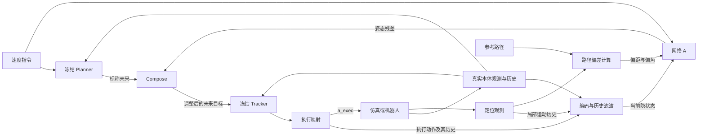
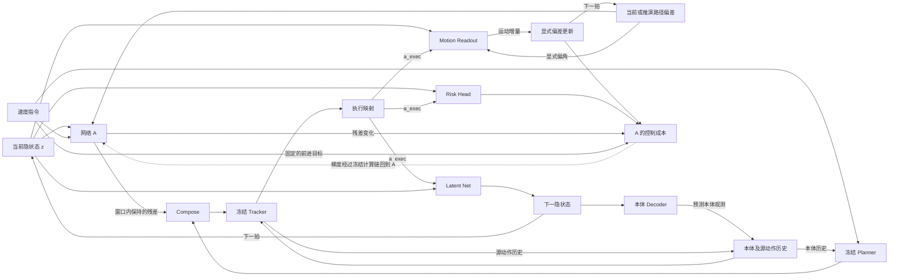

# Latent World Model 路径纠偏方法：绘图说明

## 1. 这张图要讲什么

机器人已经具备一套能行走的基础控制器：Planner 生成标称未来状态，Tracker 将这些目标转换成关节控制输入。负重、打滑等变化会使真实行走偏离参考路径。

本方法在基础控制器外增加两个学习组件：

- **网络 A**：根据机器人当前状态和路径偏差，输出小幅关节姿态残差，调整基础控制器的目标。
- **World Model（WM）**：预测这些调整将怎样改变身体状态和空间运动，为网络 A 提供可微的未来推演。

核心思路是：**先用真实执行数据学习机器人怎样运动，再通过冻结的 WM 预演修正动作，让网络 A 学会一边保持前进、一边消除路径偏差。**

本文正文记录早期想象更新 A 的结构；当前两阶段 PPO／FiLM 训练及本轮修复见第 11 节。

## 2. 先统一图中的几个对象

| 对象 | 含义 | 当前实例 |
|---|---|---|
| 本体观测 `o` | 机器人自身传感器状态 | 66 维：角速度 3、投影重力 3、相对默认姿态的关节角 29、关节速度 29、步态相位 2 |
| 隐状态 `z` | WM 对身体动态的内部表示 | 确定性记忆 128 维，加上 8 组、每组 8 类的离散随机状态；拼接特征为 192 维 |
| 速度指令 `c` | 上层要求的行走速度 | 前向、侧向、转向，共 3 维 |
| 标称未来 `Y_nom` | Planner 给出的未来状态序列，其中包含关节姿态目标 | 当前策略预测 6 个控制步，每步 66 维 |
| 姿态残差 `ΔY` | 网络 A 对关节目标施加的小幅调整 | 29 维，单位为 rad，按源策略关节顺序排列 |
| 执行输入 `a_exec` | Tracker 输出经过部署映射后的关节控制输入 | 29 维，送入环境及 WM 的动作接口 |
| 路径偏差 `e_y, e_ψ` | 当前机器人离参考线多远、朝向相差多少 | 横向距离 m、相对偏角 rad |
| 运动增量 `Δs, Δy, Δψ` | 一个时间段内实际向前、横向移动多少，以及转过多少 | 路径坐标系中的 m、m、rad |

**姿态残差与执行动作处在两个不同层级。** `ΔY` 先调整 Planner 的目标，再由 Tracker 生成 `a_exec`。图中不能直接把 `ΔY` 标成 WM 的 Action 输入。

**路径偏差与运动增量也应分开。** WM 学习预测运动增量；网络 A 根据这些增量推演未来路径偏差，并优化纠偏效果。

## 3. 当前有哪些模块

### 3.1 冻结的基础控制器

- **Planner**：根据本体观测历史和速度指令生成标称未来。当前 66 维策略的 Planner 使用观测历史与指令。
- **Compose**：将 29 维姿态残差写入标称未来的关节位置、关节速度通道。
- **Tracker**：根据身体观测历史、源动作历史及调整后的未来目标，生成本控制步的动作。
- **执行映射**：按照源策略的关节顺序、动作尺度和默认姿态等约定，生成环境输入 `a_exec`。源动作历史供 Tracker 使用，部署后的环境输入供 WM 使用。

Planner 与 Tracker 始终保持原有权重。底层 PD 和物理后端负责执行关节控制输入。

### 3.2 World Model

WM 使用 RSSM 式隐状态结构，包含以下部件：

| 部件 | 输入 | 输出 | 用途 |
|---|---|---|---|
| Encoder／历史滤波 | 本体历史、历史执行动作，以及已到达的局部运动历史 | 当前身体隐状态 `z` | 为未来推演建立真实起点 |
| Latent Net／先验动力学 | 当前隐状态 `z_t`、执行动作 `a_exec,t` | 下一隐状态 `z_t+1` | 在隐空间递推身体动态 |
| 本体 Decoder | 隐状态 | 66 维本体观测 | 为未来 Tracker 提供身体输入 |
| Motion Readout／轨迹读出头 | 当前隐状态、当前显式偏角、当前执行动作 | `Δs, Δy, Δψ` | 预测路径坐标系中的运动增量 |
| Risk Head／风险头 | 当前隐状态、当前执行动作 | 本控制步的失稳风险概率 | 为网络 A 提供风险成本 |

Encoder／历史滤波在推演起点处理一段真实历史。当前配置使用 30 个控制步的历史。严格说，单帧 Encoder 先提取观测特征，再通过 RSSM 后验滤波结合动作历史得到隐状态。

未来想象段只调用先验动力学递推，不读取未来真实观测。当前实现每一步都对离散隐状态进行随机抽样。

**Motion Readout 与 Latent Net 并行读取当前隐状态和当前动作。** 本体 Decoder 则读取状态隐变量，生成 Tracker 所需的观测。这三者不要画成一条简单的 Encoder → Latent Net → 位移 Decoder 串联链。

Decoder 虽然输出 66 维观测，想象推演中的步态相位会按源策略的已知时钟推进并覆盖对应通道。

### 3.3 网络 A 与外部路径状态

网络 A 输入当前隐状态特征、横向偏距、相对偏角和速度指令，输出有界的 `ΔY`。当前 66 维策略对应 192 + 2 + 3 维输入、29 维输出。A 初始化时输出零残差。

路径偏差保存在 WM 隐状态之外：

- 横向偏距送给网络 A。
- 相对偏角送给网络 A，也送给 Motion Readout，用来表达路径坐标系中的运动。
- 参考路径用于外部误差计算，不进入本体 Encoder 或身体动力学转移。

定位来源在当前仿真实验中是仿真位姿；部署设计中对应 SLAM。Encoder 使用的是局部相对运动历史，路径偏差另行计算。

## 4. 真实执行链：机器人实际怎样走

真实控制循环不断获得新本体观测和定位结果。网络 A 在较慢的窗口边界选择残差；Planner 和 Tracker 在底层控制步持续运行。

离线采集时，姿态残差由随机探索器提供；在线纠偏时由网络 A 提供。两者共享 Compose → Tracker → 执行映射这条控制接口。

本图把历史缓冲合并为输入模块。绘制详细版本时，应区分 Tracker 的源动作历史和 WM 的环境输入动作历史。

## 5. 想象推演链：怎样在 WM 中预演未来

每次优化网络 A，都从当前真实历史编码出的隐状态，以及当前可用的实测路径偏差出发。

历史框中的动作来自 Tracker 的源动作输出；送入 Latent Net、Motion Readout、Risk Head 的动作是部署映射后的 `a_exec`。两种动作通过部署映射关联，各自进入对应消费者。

这条循环有三个重点：

1. **未来 Action 每一步都重新计算。** 预测身体状态进入历史缓冲，Planner 更新标称未来，Tracker 再生成动作。
2. **身体状态与空间运动由不同读出负责。** Decoder 闭合控制器输入；Motion Readout 预测空间增量。
3. **冻结的是权重，不是输入梯度。** 梯度经过 WM、Compose 和基础控制器的计算，最终只更新 A。

每次新的真实决策都会重新使用实测状态与实测偏差作为起点。WM 中的偏差累加只服务于有限时域想象，不代替长期真实定位。

### 当前时间尺度

| 项目 | 当前这轮配置 |
|---|---|
| 底层控制周期 | 0.02 秒，即 50 Hz |
| 一个残差窗口 | 10 个控制步，即 0.2 秒 |
| WM 预训练展开 | 2 个窗口，即 20 个控制步、0.4 秒 |
| 网络 A 默认想象时域 | 2 个窗口；随每个底层步推进 Planner–Tracker |
| 已做离线滚动检查 | 1、2、4 个窗口，即 0.2、0.4、0.8 秒 |

A 在窗口内保持该残差；Planner、Tracker、Latent Net 和各读出头按底层步运行。

## 6. State 与 Position 之间的连接

本方法没有要求高维关节状态直接等于空间位置，而是让同一个隐状态承担两个相互配合的用途：

- 通过身体动力学和 Decoder，描述身体将怎样变化，供 Tracker 继续控制。
- 通过 Motion Readout，将当前身体动态、执行动作与朝向转换成路径坐标系中的位移和转角。

因此，原先讨论的转换函数 `T`，在当前实现里对应**学习得到的运动读出头**。它与动力学并行工作，不是仅靠下一帧关节角做几何换算。

真实位姿由定位系统提供。WM 的运动增量用于预测短期纠偏后果，并接受定位测量的监督。

## 7. 怎么训练、怎么在线更新

### 7.1 离线预训练 WM

在仿真中运行冻结的基础控制器，施加有界姿态扰动，记录实际执行动作、本体观测和空间运动。训练集与验证集来自独立采集轨迹。

监督拟合时，WM 每一步的 Action 都来自真实执行日志，其预测与该动作对应的真实后继状态、真实运动配对。未来隐状态采用自回归展开。

当前 WM 的损失可以按四组理解：

| 损失组 | 监督对象 |
|---|---|
| 本体重建 | 用后验状态重建当前真实本体；用多步先验状态预测未来真实本体 |
| 隐状态一致性 | 后验与先验的 KL，以及多步先验与对应后验的 KL 对齐 |
| 运动预测 | 底层步的位移／转角预测，以及窗口汇总运动，与实测运动增量对齐 |
| 风险预测 | 根据倾角超限、终止等标签监督风险头 |

实际实现使用 RSSM 的 KL 一致性，不是简单的隐向量平方差。编码器、后验、先验和各读出头在离线阶段共同训练；Planner 与 Tracker 不参与这个优化器。

当前预训练入口训练 WM，网络 A 另行初始化。当前结构没有 Critic 或 CEM 采样规划器。

### 7.2 在线更新 WM 的 LoRA

真实执行产生近期连续窗口，回放池保留对应本体、实际 Action 和定位运动标签。

- 冻结 Encoder、后验网络、本体 Decoder、风险头和原始主干权重。
- 仅更新 Latent Net 中的 `prior_net` 与 Motion Readout 中 `motion_head` 的线性层 LoRA。
- 使用本体、潜变量与运动监督更新；在线风险监督权重为零。

当前在线更新仍调用完整 WM 损失。因此，“轨迹误差 + 隐变量误差”是此前讨论的概括；当前实现还保留了通过冻结 Decoder 反传的本体重建约束。

### 7.3 冻结 WM，更新网络 A

更新 A 时，将 WM 及 LoRA 一起冻结，执行第 5 节的想象闭环。A 最小化五项正向成本：

| 成本 | 作用 |
|---|---|
| 横向偏距 | 拉回参考路径 |
| 实际横向速度 | 抑制带着侧向运动冲过参考线 |
| 前向推进 | 保持上层要求的前进任务 |
| 残差变化率 | 抑制突然改变姿态，允许持续的非零配平 |
| 失稳风险 | 对预测风险直接加罚 |

前进目标由初始速度指令投影到路径方向后固定，梯度不通过这个目标改变其数值。风险成本按物理时间汇总。

离线与在线 WM 拟合使用日志动作；优化 A 时的未来动作则由想象中的 Planner–Tracker 现场生成。这两条训练链应在图中分开。

## 8. 绘图建议

建议将总图分成三个区域：

1. **左侧：真实执行与数据。** 环境、本体传感器、定位、参考路径、基础控制器，以及真实日志。
2. **中间：WM 想象闭环。** 初始状态编码、Latent Net、本体 Decoder、Motion Readout、Risk Head；突出 Decoder 回到 Planner–Tracker 的反馈线。
3. **右侧：两个学习循环。** 真实日志监督 WM 的 LoRA；想象控制成本通过冻结计算链更新 A。

统一图例：

- 实线表示前向数据流。
- 虚线表示梯度或监督关系，并用不同线型／标签区分二者。
- 冻结模块用锁标识；可训练模块用参数更新标识。
- Encoder 与身体隐状态使用一种颜色；外部路径偏差使用另一种颜色。
- LoRA 画成附着在 Latent Net 和 Motion Readout 上的小标签。

主图保留因果结构，维度、时钟和损失细目可以放在侧栏。源文件名、checkpoint 路径和实验结果不进入方法主图。

## 9. 当前已发现的问题：作为诊断插图

当前这轮 WM 已完成 10000 次预训练。验证窗口 XY RMSE 最低约 1.27 cm；独立基线在 0.2～0.8 秒展开下，每个 0.2 秒窗口的平均误差约 1.3 cm。

进一步的同起点正负扰动试验发现，完整想象控制链的局部动作响应方向出现错误。离线诊断确认以下两点：

### 问题 A：本体重建误差被控制器放大

在已观测的当前状态上，编码再解码的关节角 RMSE 约 0.48°、关节速度 RMSE 约 0.26 rad/s。将重建观测替换真实观测后，冻结 Planner–Tracker 产生的动作差约为本次正负扰动动作差的 12 倍。

图中在 **Decoder → Planner–Tracker** 的连线上标注：**本体重建误差放大，掩盖细小纠偏信号。**

### 问题 B：随机推演的局部响应不稳定

固定初始隐状态，输入同一批已记录真实 Action，仅改变未来模型采样。16 次采样中，横向和转向响应分别只有 5 次与实测方向一致。

图中在 **Latent Net 的随机状态递推** 旁标注：**采样波动影响局部动作响应方向。**

### 改进方向：单独画成待验证标注

当前损失与模型选择侧重平均预测误差，还没有“重建状态通过冻结控制器后，应产生一致动作”的控制一致性约束。

后续方向是：**在相同控制目标下，要求真实观测与 WM 重建观测产生接近的控制动作，并以局部响应方向的稳定性验收。** 这项约束尚未实现，不应画成已有损失。

诊断插图与方法主图分开。主图展示系统如何工作；诊断插图展示当前这版模型在哪里尚未达到控制要求。

## 10. 实现定位

以下链接供画图 Agent 核对细节，正文已经给出绘图所需的设计语义。

- [基础 Planner–Tracker 执行控制器](../src/unilab/algos/torch/distill/fada/playback.py)
- [WM 编码、后验、先验及各读出头](../src/unilab/algos/torch/sttt/world_model/model.py)
- [离散随机隐状态采样](../src/unilab/algos/torch/sttt/world_model/reference.py)
- [冻结控制链的想象 Rollout](../src/unilab/algos/torch/sttt/path_following/latent_rollout.py)
- [网络 A](../src/unilab/algos/torch/sttt/path_following/latent_actor.py)
- [网络 A 五项控制成本](../src/unilab/algos/torch/sttt/path_following/latent_objectives.py)
- [WM 损失与预训练历史滤波](../src/unilab/algos/torch/sttt/world_model/losses.py)
- [在线 LoRA 与 A 更新](../src/unilab/algos/torch/sttt/world_model/online.py)
- [在线真实状态与定位接入](../src/unilab/algos/torch/sttt/path_following/latent_runtime.py)
- [同起点动作响应探针](../src/unilab/algos/torch/sttt/path_following/latent_response_probe.py)
- [本轮预训练配置](../conf/sttt/latent_world_model.yaml)
- [在线学习配置](../conf/sttt/latent_path_following_online.yaml)

本轮模型与探针身份：

- 基础策略：`model/mixup_0kg/student_iter_0031.pt`。
- WM：`outputs/wm_pretrain/20261121_064652/best.pt`。
- 响应探针：`outputs/wm_response_probe/20261121_074928/`。

## 11. 当前两阶段训练与修复

- 阶段 1 在真实仿真中用 RSL-RL PPO 训练 A；WM 同时以实际执行 Action 和真实后继观测做监督学习。阶段 2 冻结基础 A 和 WM，训练 FiLM 的适配能力；部署时保留并更新上下文向量 c。
- A 的身体成本使用实测关节软限位、关节加速度、身体倾角与终止事件；平顺成本作用于窗口间 ΔY 的变化率，允许恒定非零配平。Planner 中间输出不作为关节运动真值。
- WM 运动头内部预测区间平均速度，乘 checkpoint 记录的控制步长后返回原有 m、m、rad 增量。运动头使用独立学习率和梯度裁剪，并进行学习率预热；数据标签和坐标系保持不变。
- 热身模型按平移、偏航、关节位置／速度、角速度与重力方向的归一化误差共同选择。切入 PPO 时使用选中的 WM，并重置其优化器动量，实际已执行更新总数保持记录。
- 参考指令平滑插值；曲率与速度共同约束转向需求，采集和想象使用同一指令范围。序列仍记录实际 Action，而非姿态残差。
- 默认物理工况包含 nominal、有界偏载与摩擦变化，传感器噪声保持关闭。episode 在 reset 时分配到训练或独立验证回放池；所有前缀沿用同一分区。
- 默认每 125 轮 PPO 检查 A／WM，保存绑定同一物理模型身份的轻量权重，并与同工况零残差控制比较；包含完整 replay 的恢复 checkpoint 继续低频保存。风险验证无正例时明确报告不可评估。
- 启动日志记录原生控制步长、残差窗口时长、WM／c 推演总秒数与 29 维残差限幅。现有默认 0.02 s × 10 步 × 2 窗口对应 0.4 s。
- 原始轨迹仍可复用；WM、联合训练和在线 checkpoint 的版本已随速度读出语义升级，旧增量读出 checkpoint 不再混载。
